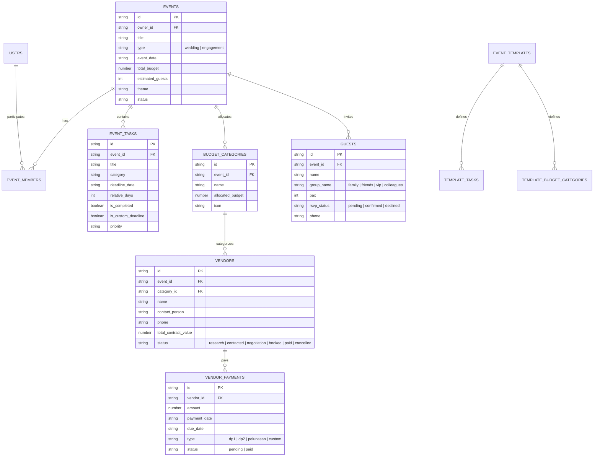

# Analisis Mendalam PRD & Blueprint Arsitektur Aplikasi Wedding & Engagement Planner MVP

Dokumen ini menyajikan evaluasi kritis terhadap [PRD Wedding & Engagement Planner MVP](file:///home/bms-del214/development/time/time/wedding-planner/prd_wedding_engagement_planner_mvp.md), identifikasi edge-case/risiko teknis, spesifikasi formula, skema database relasional lengkap, serta rencana bertahap (roadmap) implementasi aplikasi.

---

## 1. Analisis & Evaluasi Strategis PRD

### 1.1. Kekuatan Konseptual PRD (Strengths)
1. **Diferensiasi yang Sangat Tajam (Budget Intelligence):**
   - Kebanyakan aplikasi pernikahan hanya berupa *static checklist* atau *marketplace* vendor. Model 4 pilar cashflow (**Budget, Paid, Committed, Available**) menyelesaikan masalah nyata (*pain point*) pasangan: ketidaktahuan berapa sisa uang riil setelah meneken kontrak vendor bernilai besar sebelum jatuh tempo pelunasan.
2. **Onboarding Wizard dengan Time-to-Value Cepat:**
   - Strategi duplikasi data dari `event_templates` ke data transaksional instan memberikan "Aha! moment" dalam < 3 menit tanpa memaksa pengguna mengetik puluhan tugas dari nol.
3. **Dynamic Timeline (Relative Deadlines `H - X`):**
   - Logika penjadwalan relatif mencegah stres akibat revisi manual ketika tanggal pernikahan dimajukan/diundur.
4. **Scoping MVP yang Disiplin (P0 vs Out of Scope):**
   - Menunda marketplace, payment gateway, dan seating drag-and-drop adalah keputusan tepat agar rilis cepat (Fast Time to Market) dan validasi core value tercapai.

---

### 1.2. Analisis Kritis & Celah Logika (Gaps & Edge Cases)

| Area | Isu / Celah dalam PRD | Rekomendasi Solusi Teknis |
| :--- | :--- | :--- |
| **Budget Variance Calculation** | Pembagian dengan nol (*Division by Zero*) jika `budget_amount = 0` (misal ada pengeluaran tak terduga tanpa alokasi awal). | Jika `budget_amount == 0`, jika `actual > 0` set variance ke `+100%` (atau tampilkan flag "Unbudgeted"). Formula aman: `budget_amount > 0 ? ((actual - budget) / budget) * 100 : (actual > 0 ? 100 : 0)`. |
| **Definisi `actual_amount`** | PRD menyebut `variance_amount = actual_amount - budget_amount`, namun pilar budget memiliki `Paid` dan `Committed`. Apakah `actual_amount` = `Paid` atau `Paid + Committed`? | Dalam terminologi project management / procurement, **Actual Commitment** = `Paid + Committed`. Kontrak yang sudah ditandatangani (*Committed*) adalah kewajiban hukum yang pasti keluar. Maka: `actual_amount = Paid + Committed`. |
| **Rescheduling Event Date** | Jika user memajukan/mengundurkan tanggal acara di pengaturan, bagaimana dengan task yang sudah lewat (*overdue*) atau task yang deadlinenya sudah dimodifikasi manual oleh user (*custom deadline*)? | Berikan flag `is_custom_deadline: boolean` pada task. Jika `false`, ikuti formula `event_date - relative_days`. Jika `true`, pertahankan tanggal kustom atau berikan opsi dialog konfirmasi. Task dengan status `completed` tidak perlu diubah. |
| **Vendor Cancellation & Refund** | PRD memiliki status vendor `Cancelled`, namun belum mendefinisikan apa yang terjadi pada `Committed` dan pembayaran termin yang sudah `Paid`. | Jika status vendor menjadi `Cancelled`, sisa `Committed` harus kembali menjadi `0`. Jika ada pengembalian uang (*refund*), catat entri transaksi negatif/koreksi pada pembayaran. |
| **Guest List: Pax vs Guest** | Tamu undangan sering kali membawa pasangan/keluarga (+1 atau lebih). Menghitung `guests` hanya berdasarkan baris nama akan meleset dari perhitungan katering (*Catering headcount*). | Tambahkan atribut `pax` (default = 1, bisa diset 2 untuk pasangan atau 3+ untuk keluarga). Agregat kapasitas katering dihitung dari $\sum pax$ tamu `Confirmed`. |
| **Kolaborasi Pasangan (Concurrency)** | Pasangan mengedit budget/vendor di saat bersamaan dapat memicu *race condition* atau *overwrite data*. | Gunakan state management reactive, optimistic UI updates, dan penanda `last_modified_by`. |

---

## 2. Arsitektur Data & Model Relasional

---

## 3. Formulasi Bisnis & Logika Kalkulasi Inti

### 3.1. Rumus 4 Pilar Budgeting
1. **Total Budget ($B_{total}$):** Diambil dari `events.total_budget` atau $\sum$ `budget_categories.allocated_budget`.
2. **Total Paid ($P_{total}$):**
   $$P_{total} = \sum \text{amount dari } \text{vendor\_payments di mana status = 'paid'}$$
3. **Total Committed ($C_{total}$):**
   $$C_{vendor} = \max(0, \text{vendor.total\_contract\_value} - \text{Paid}_{vendor}) \quad \text{untuk vendor dengan status 'booked'}$$
   $$C_{total} = \sum C_{vendor}$$
4. **Total Available ($A_{total}$):**
   $$A_{total} = B_{total} - (P_{total} + C_{total})$$

### 3.2. Indikator Variansi & Status Visual
Status dihitung dari persentase selisih komitmen aktual terhadap budget:
- `Variance Amount` = $(Paid + Committed) - Budget$
- `Variance %` = $\frac{(Paid + Committed) - Budget}{Budget} \times 100$

- `≤ -20%` : **Sangat Hemat** (Hijau Tua)
- `> -20% s/d -10%` : **Hemat** (Hijau Muda)
- `> -10% s/d 0%` : **Sesuai / Efisien** (Hijau Netral)
- `0%` : **Pas Budget** (Biru / Netral)
- `> 0% s/d 10%` : **Sedikit Over** (Kuning)
- `> 10% s/d 20%` : **Over Budget** (Oranye)
- `> 20%` : **Sangat Over Budget** (Merah)

---

## 4. Alur Interaksi & State Onboarding (The 3-Minute Aha! Moment)

1. **Input Wizard:**
   - **Step 1:** Tipe Acara (`wedding` / `engagement`).
   - **Step 2:** Tanggal Acara $\rightarrow$ Menentukan anchor date $H$.
   - **Step 3:** Target Total Budget (misal: Rp 150.000.000).
   - **Step 4:** Estimasi Tamu (misal: 300 pax).
   - **Step 5:** Tema/Konsep (Indoor, Outdoor, Tradisional, Modern).
2. **Template Duplication Engine:**
   - Alokasi anggaran otomatis: Venue & Catering (40%), Dekorasi (15%), Dokumentasi (10%), Busana & MUA (10%), Entertainment (7%), Undangan & Souvenir (5%), Lain-lain/Kontingensi (13%).
   - Auto-generate puluhan checklist tasks dengan deadline `H - relative_days`.
3. **Pendaratan Dashboard:**
   - Pengguna langsung melihat: "Hari-H dalam 180 hari", "24 Tugas telah disiapkan", visual gauge "Budget Rp 150 Jt teralokasi di 7 pos".

---

## 5. Rencana Pengembangan (Implementation Plan)

- **Tahap 1: Inisialisasi Stack & Project Scaffolding**
  - Setup React 18+ / Next.js / Vite + Tailwind CSS + Lucide Icons.
  - Setup mock data & template engine (Pernikahan & Lamaran).
- **Tahap 2: Onboarding Wizard (Step 1 - 5)**
  - Form interaktif dengan validasi & preview animasi loading "Generating Your Personalized Wedding Plan...".
- **Tahap 3: Executive Dashboard**
  - Countdown timer interaktif, progress task ring/bar, snapshot budget, dan widget 3 tugas terdekat.
- **Tahap 4: Smart Checklist & Timeline**
  - Relative deadline calculator `H - X hari`, filter kategori, toggle done/undone, dan timeline gantt/bulan view.
- **Tahap 5: Budget Intelligence & Vendor Tracker**
  - 4 pilar tracker (Budget, Paid, Committed, Available) lengkap dengan color-coded variance alert.
  - Pipeline vendor (Research $\rightarrow$ Booked $\rightarrow$ Paid) dan pencatatan termin pembayaran (DP 1, DP 2, Pelunasan).
- **Tahap 6: Guest List & Couple Collaboration**
  - RSVP tracking, kelompok tamu, ringkasan headcount katering, serta simulasi kolaborasi pasangan (Owner vs Editor).
